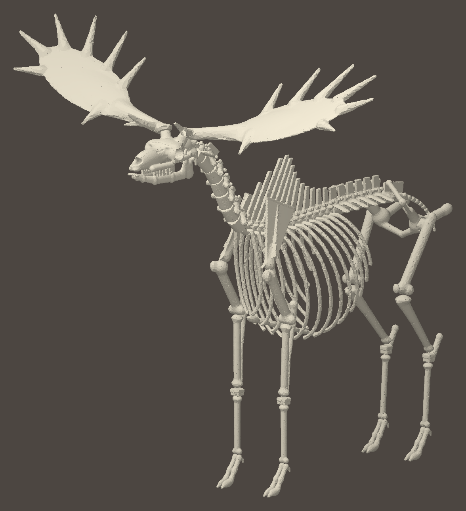

# 3D-Modell Riesenhirsch

Megaloceros giganteus, erwachsener Hirsch mit Geweih, stehend. Erstes Modell nach
[`../MODELLING_RULES.md`](../MODELLING_RULES.md), Vorbild ist der Höhlenbär. Noch nicht ins Spiel
eingebunden und kein Arbeitspaket aus `docs/GAME_DESIGN.md`.



## Dateien

| Datei | Inhalt |
|---|---|
| `bones/<id>.glb` | Ein Knochen. Paarige Knochen enden auf `_l` bzw. `_r`. |
| `bones.json` | Liste aller Knochen: `id`, Datei, Gruppe, Seite, Name (de/en), Bounding-Box, Dreiecke |
| `giant_deer_all.glb` | Alle Knochen in einer Datei, jeder als eigener Knoten mit seiner `id` |
| `bones_viewer.html` | Betrachter für `giant_deer_all.glb` (über einen lokalen Webserver öffnen) |
| `preview/` | Ansichten ohne Perspektive: Seite, vorn, oben, schräg, Schädel |

113 Knochen, 148 476 Dreiecke, `giant_deer_all.glb` 2,6 MB:

- Schädel 20: Hinterhaupt, Keilbein, je Seite Zwischenkiefer, Nasenbein, Oberkiefer, Jochbein,
  Schläfenbein, Stirnbein, Scheitelbein, Unterkieferhälfte und Geweihstange
- Wirbel: 7 Hals, 13 Brust, 6 Lenden, Kreuzbein, 11 Schwanz
- 26 Rippen, Brustbein, 2 Hüftbeine
- je Vorderbein 7: Schulterblatt, Oberarm, Speiche, Elle, Handwurzel, Kanonenbein, Zehen
- je Hinterbein 6: Oberschenkel, Kniescheibe, Schienbein, Fußwurzel, Kanonenbein, Zehen

Koordinaten wie beim Höhlenbären: x nach hinten, y nach oben, z zur linken Seite. Eine Einheit ist
die Schädellänge, hier 0,50 m (`unitMeters` in `bones.json`). Der Boden liegt bei y = -4,02.

## Maße

Zielwerte stehen mit Quellen in `tools/models3d/species/giant_deer.py` (`MEASURES_MM`). Am fertigen
Mesh nachgemessen:

| Maß | Ziel | Modell |
|---|---|---|
| Schädel | 500 mm | 509 mm |
| Oberarm | 380 mm | 382 mm |
| Speiche | 410 mm | 409 mm |
| Vorderes Kanonenbein | 330 mm | 330 mm |
| Oberschenkel | 480 mm | 479 mm |
| Schienbein | 470 mm | 461 mm |
| Hinteres Kanonenbein | 360 mm | 359 mm |
| Schulterblatt | 430 mm | 435 mm |
| Geweihstange | 1350 mm | 1302 mm |
| Geweihspanne | 2700 mm | 2580 mm |
| Widerristhöhe (Skelett) | 1900 mm | 1833 mm |

Quellen: Lister & Stuart 2019 (Quaternary International), Shpansky 2014 (Paleontological Journal),
Aaris-Sørensen & Liljegren 2004 (Boreas), Croitor 2021 (Quaternary).

## Annahmen

- Schulterblattlänge, Rumpflänge, Brustkorbtiefe, Becken und alle Knochendicken sind nach Fotos
  montierter Skelette geschätzt, nicht gemessen.
- Wirbelformel wie bei heutigen Hirschen: 7 Hals-, 13 Brust-, 6 Lendenwirbel, 13 Rippenpaare.
  Schwanzwirbel schwanken bei Hirschen zwischen 10 und 14, hier 11.
- Der Kopf liegt waagerecht (Regel 2.2). Ein lebendes Tier trug die Schnauze etwas tiefer.
- Geweihform frei nach typischen Stücken: Stange, Schaufel mit sieben Sprossen, gegabelte
  Augsprosse. Die Spanne liegt im unteren Bereich der belegten 2,3 bis 3,5 m.

## Besonderheiten gegenüber dem Höhlenbären

- **Geweih:** `antler_l` und `antler_r` sind eigene Knochen in der Gruppe `skull`. Der Rosenstock
  gehört zum Stirnbein.
- **Kein Wadenbein:** Bei Wiederkäuern ist es bis auf einen kleinen Rest zurückgebildet.
- **Kanonenbein statt Pfote:** Mittelhand und Mittelfuß sind je ein großer Knochen
  (`metacarpal`, `metatarsal`). Handwurzel (`carpus`), Fußwurzel mit Fersenbein (`tarsus`) und
  die Zehen mit Hufen und Afterklauen (`forefoot`, `hindfoot`) sind je Bein ein Teil.
- **Keine oberen Schneide- und Eckzähne.** Backenzähne sitzen am Oberkiefer und Unterkiefer.
- **Formen in Python statt im Shader:** Es gibt keine `skeleton.html`. Die Formen stehen in
  `tools/models3d/species/giant_deer.py` und werden direkt vernetzt, ohne Browser.

## Neu erzeugen und prüfen

```
python3 tools/models3d/build.py giant_deer     # Meshes, bones.json, giant_deer_all.glb
python3 tools/models3d/check.py giant_deer     # Regeln prüfen, muss 0 Fehler melden
python3 tools/models3d/render.py giant_deer    # Ansichten nach preview/
python3 tools/models3d/render.py giant_deer --group skull
```

Braucht `numpy`, `scipy`, `scikit-image`, `trimesh`, `fast-simplification` und `Pillow`.
Einzelne Knochen neu bauen: `build.py giant_deer femur tibia` (Anfang der `id`).

## Offene Punkte

- Die Meshes sind schlichter als die Shader-Ansicht des Höhlenbären: glatte Flächen, wenig
  Relief an Gelenkenden, Rippen mit rundem Querschnitt.
- Größte verbleibende Durchdringungen: 1. und 2. Brustwirbel sowie Hüftbein und Oberschenkelkopf,
  je 1,8 % des kleineren Knochens (erlaubt sind 2 %).
- Keine Qualitätsschäden in der Geometrie. Ob Schaden per Material oder per Mesh gezeigt wird,
  ist mit der Wahl des 3D-Renderers offen (Design Kapitel 8).
- Der Höhlenbär erfüllt die neuen Regeln noch nicht, siehe Regeln Kapitel 9.
